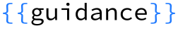
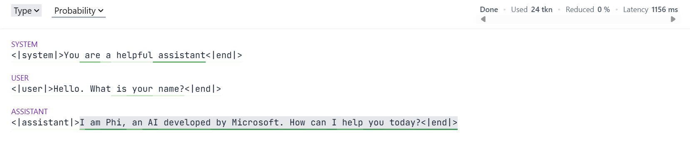
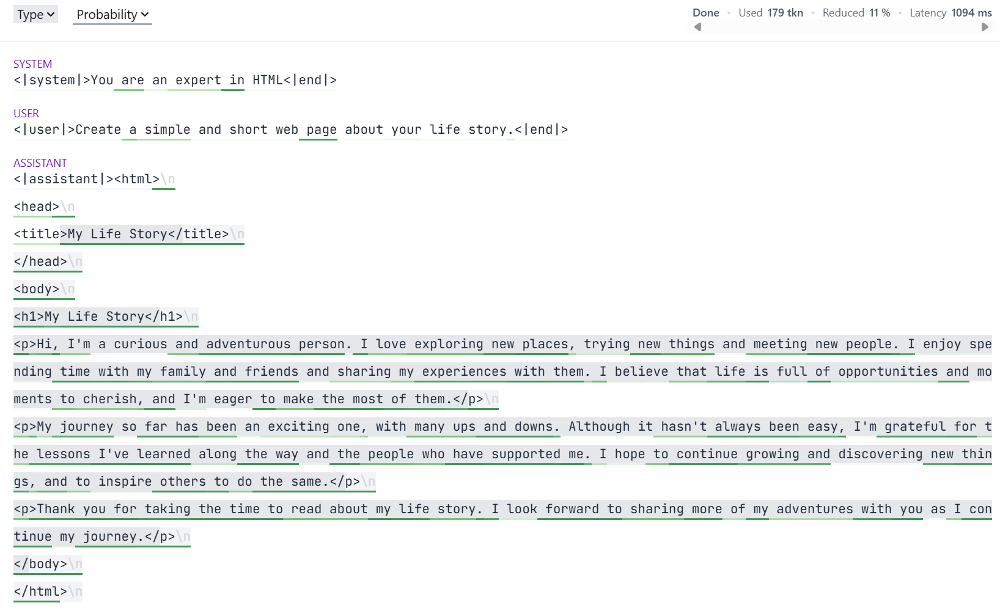

<div align="right">
  <a href="https://discord.gg/cjPfAK43dz"></a>
  <a href="mailto:guidanceai@microsoft.com"></a>
  
</div>
<div align="center"><picture>
  <source media="(prefers-color-scheme: dark)" srcset="docs/figures/guidance_logo_blue_dark.svg">
  
</picture></div>
<br/>

<p align="center">
  <a href="README.md">English</a> · <b>简体中文</b>
</p>

**Guidance 是一种用于高效引导与精确控制大语言模型（LLM）的编程范式。** 借助 Guidance，您可以完全掌控输出的结构规范，并针对具体业务场景获得极高确定性的高质量结果——*与传统的提示词工程（Prompting）或模型微调相比，能大幅降低推理延迟与调用成本。* 它允许用户通过正则表达式（Regex）与上下文无关文法（CFG）严格约束生成内容，并将逻辑控制流（条件分支、循环、工具调用）与模型生成无缝交错融合。

   * [安装指南](#安装指南)
   * [核心特性](#核心特性)
     * [面向大模型的 Pythonic 编程接口](#面向大模型的-pythonic-编程接口)
     * [通过约束生成保证语法规范](#通过约束生成保证语法规范)
     * [离线调试文法（无需调用模型-api）](#离线调试文法无需调用模型-api)
     * [创建自定义 Guidance 函数](#创建自定义-guidance-函数)
     * [组合文法与 Token 快进机制](#组合文法与-token-快进机制)
     * [生成结构化 JSON 数据](#生成结构化-json-数据)


## 安装指南
Guidance 可通过 PyPI 直接安装，支持多种推理后端（Transformers、llama.cpp、OpenAI 等）。
若您的环境中已安装对应模型所需的推理库，直接运行以下命令即可：
```bash
pip install guidance
```

## 核心特性

### 面向大模型的 Pythonic 编程接口

使用 Guidance 时，您可以使用最符合 Python 惯用语法的直观方式与大语言模型交互：

```python
from guidance import system, user, assistant, gen
from guidance.models import Transformers

# 亦可选用 LlamaCpp 或其他支持的模型后端
phi_lm = Transformers("microsoft/Phi-4-mini-instruct")

# 模型对象具有不可变性（Immutable），因此此处为安全副本
lm = phi_lm

with system():
    lm += "You are a helpful assistant"

with user():
    lm += "Hello. What is your name?"

with assistant():
    lm += gen(max_tokens=20)

print(lm)
```
在终端命令行中执行时，将输出如下文本：
```
<|system|>You are a helpful assistant<|end|><|user|>Hello. What is your name?<|end|><|assistant|>I am Phi, an AI developed by Microsoft. How can I help you today?
```
如果在 Jupyter Notebook 环境中运行，Guidance 还提供了精美的可视化交互小部件：



在 Guidance 中捕获提取生成的变量极为简便：

```python
# 获取一份新的模型副本
lm = phi_lm

with system():
    lm += "You are a helpful assistant"

with user():
    lm += "Hello. What is your name?"

with assistant():
    lm += gen(name="lm_response", max_tokens=20)

print(f"{lm['lm_response']=}")
```

```
lm['lm_response']='I am Phi, an AI developed by Microsoft. How can I help you today?'
```

### 通过约束生成保证语法规范

Guidance 提供了简单易用且功能极其强大的语法，用于在生成采样阶段严格约束语言模型的输出。
例如，`gen()` 调用可被强制约束为必须匹配特定正则表达式：

```python
lm = phi_lm

with system():
    lm += "You are a teenager"

with user():
    lm += "How old are you?"

with assistant():
    lm += gen("lm_age", regex=r"\d+", temperature=0.8)

print(f"The language model is {lm['lm_age']} years old")
```

```
The language model is 13 years old
```

很多时候，我们预先知道输出必然属于某个固定的候选项列表。
Guidance 专门提供了 `select()` 函数来满足这一场景：

```python
from guidance import select

lm = phi_lm

with system():
    lm += "You are a geography expert"

with user():
    lm += """What is the capital of Sweden? Answer with the correct letter.

    A) Helsinki
    B) Reykjavík 
    C) Stockholm
    D) Oslo
    """

with assistant():
    lm += select(["A", "B", "C", "D"], name="model_selection")

print(f"The model selected {lm['model_selection']}")
```

```
The model selected C
```

Guidance 提供的约束系统异常强大。
只要底层推理后端完整支持 Guidance，它能够确保模型的输出严格符合任意上下文无关文法（Context-Free Grammar, CFG）。详见下文。

### 离线调试文法（无需调用模型 API）

在设计和迭代文法约束规则时，您完全可以在本地离线验证目标候选字符串，并借助 `Mock` 模型进行端到端的模拟测试：

```python
from guidance import gen
from guidance.models import Mock

grammar = "expr=" + gen(regex=r"\d+([+*]\d+)*", name="expr")

# 1) 直接针对文法校验字符串合法性
assert grammar.match("expr=12+7*3") is not None
assert grammar.match("expr=12+*3") is None

# 2) 结合本地 Mock 模型运行相同的文法规则
lm = Mock(b"<s>expr=12+7*3")
lm += grammar
print(lm["expr"])  # 12+7*3
```

### 创建自定义 Guidance 函数

借助 Guidance，您可以轻松构建能够与大语言模型自由交互的自定义函数。
只需使用 `@guidance` 装饰器进行标记即可。
假设我们需要让模型批量回答多项选择题，可以按如下方式实现：

```python
import guidance

from guidance.models import Model

ASCII_OFFSET = ord("a")

@guidance
def zero_shot_multiple_choice(
    language_model: Model,
    question: str,
    choices: list[str],
):
    with user():
        language_model += question + "\n"
        for i, choice in enumerate(choices):
            language_model += f"{chr(i+ASCII_OFFSET)} : {choice}\n"

    with assistant():
        language_model += select(
            [chr(i + ASCII_OFFSET) for i in range(len(choices))], name="string_choice"
        )

    return language_model
```
接下来定义测试问题：
```python
questions = [
    {
        "question" : "Which state has the northernmost capital?",
        "choices" : [
            "New South Wales",
            "Northern Territory",
            "Queensland",
            "South Australia",
            "Tasmania",
            "Victoria",
            "Western Australia",
        ],
        "answer" : 1,
    },
    {
        "question" : "Which of the following is venomous?",
        "choices" : [
            "Kangaroo",
            "Koala Bear",
            "Platypus",
        ],
        "answer" : 2,
    }
]
```
我们可以像调用 `gen()` 或 `select()` 一样直接调用被修饰的自定义函数，`language_model` 参数将由系统自动注入：
```python
lm = phi_lm

with system():
    lm += "You are a student taking a multiple choice test."

for mcq in questions:
    lm_temp = lm + zero_shot_multiple_choice(question=mcq["question"], choices=mcq["choices"])
    converted_answer = ord(lm_temp["string_choice"]) - ASCII_OFFSET
    print(lm_temp)
    print(f"LM Answer: {converted_answer},  Correct Answer: {mcq['answer']}")
```

```
<|system|>You are a student taking a multiple choice test.<|end|><|user|>Which state has the northernmost capital?
a : New South Wales
b : Northern Territory
c : Queensland
d : South Australia
e : Tasmania
f : Victoria
g : Western Australia
<|end|><|assistant|>b
LM Answer: 1,  Correct Answer: 1
<|system|>You are a student taking a multiple choice test.<|end|><|user|>Which of the following is venomous?
a : Kangaroo
b : Koala Bear
c : Platypus
<|end|><|assistant|>c
LM Answer: 2,  Correct Answer: 2
```

### 组合文法与 Token 快进机制

Guidance 函数支持灵活嵌套与组合，从而能够构建出完整的上下文无关文法。
例如，我们可以通过编写多个 Guidance 函数来生成简单的 HTML 网页（注：此处并非完整的 HTML 规范实现）。
首先，我们编写一个生成不包含任何 HTML 标签纯文本的基础函数。函数通过 `stateless=True` 标明其为无状态函数，专用于参与文法组合：

```python
@guidance(stateless=True)
def _gen_text(lm: Model):
    return lm + gen(regex="[^<>]+") 
```

随后，利用该函数在任意指定的 HTML 标签内生成文本：
```python
@guidance(stateless=True)
def _gen_text_in_tag(lm: Model, tag: str):
    lm += f"<{tag}>"
    lm += _gen_text()
    lm += f"</{tag}>"
    return lm
```
接下来定义页面 Header 部分，其中包含生成网页标题：
```python
@guidance(stateless=True)
def _gen_header(lm: Model):
    lm += "<head>\n"
    lm += _gen_text_in_tag("title") + "\n"
    lm += "</head>\n"
    return lm
```
HTML 页面的主体由标题与段落构成，分别定义生成函数：
```python
from guidance.library import one_or_more

@guidance(stateless=True)
def _gen_heading(lm: Model):
    lm += select(
        options=[_gen_text_in_tag("h1"), _gen_text_in_tag("h2"), _gen_text_in_tag("h3")]
    )
    lm += "\n"
    return lm

@guidance(stateless=True)
def _gen_para(lm: Model):
    lm += "<p>"
    lm += one_or_more(
        select(
            options=[
                _gen_text(),
                _gen_text_in_tag("em"),
                _gen_text_in_tag("strong"),
                "<br />",
            ],
        )
    )
    lm += "</p>\n"
    return lm
```
定义包含整个 HTML 页面 Body 的组合函数：
```python
@guidance(stateless=True)
def _gen_body(lm: Model):
    lm += "<body>\n"
    lm += one_or_more(select(options=[_gen_heading(), one_or_more(_gen_para())]))
    lm += "</body>\n"
    return lm
```
组装完整生成整份 HTML 页面的入口函数：先添加 HTML 开始标签，再生成 Header、Body，最后闭合 HTML 标签：
```python
@guidance(stateless=True)
def _gen_html(lm: Model):
    lm += "<html>\n"
    lm += _gen_header()
    lm += _gen_body()
    lm += "</html>\n"
    return lm
```
最后，封装一个对用户更加友好的顶层函数，支持：
- 自定义采样温度（Temperature）
- 自动将生成的页面文本捕获到 Model 变量中
```python
from guidance.library import capture, with_temperature

@guidance(stateless=True)
def make_html(
    lm,
    name: str | None = None,
    *,
    temperature: float = 0.0,
):
    return lm + capture(
        with_temperature(_gen_html(), temperature=temperature),
        name=name,
    )
```
现在即可调用它生成一份简单的个人故事网页：
```python
lm = phi_lm

with system():
    lm += "You are an expert in HTML"

with user():
    lm += "Create a simple and short web page about your life story."

with assistant():
    lm += make_html(name="html_text", temperature=0.7)
```

在 Jupyter Notebook 中执行时，可视化组件呈现如下效果：



请注意生成文本中颜色深浅各异的高亮显示。
这展现了 Guidance 的另一项核心杀手级特性：**Token 快进技术（Fast-forwarding of tokens）**。
文法施加的结构约束往往意味着某些 Token 在逻辑上是 100% 确定已知的。
对于这类确定性的 Token，Guidance 根本不需要调用大模型进行预测生成，而是直接将其快进插入到生成流中。
这种机制省去了大量的模型前向计算（Forward Passes），从而显著削减了 GPU 算力消耗并大幅降低延迟。
例如，在上述 HTML 生成中，Guidance 始终知晓最近打开的标签名。如果刚刚打开的标签是 `<h1>`，那么一旦模型输出了闭合前缀 `</`，Guidance 能够立刻瞬时填入 `h1>`，全程无需模型执行任何前向计算。

### 生成结构化 JSON 数据

JSON Schema 本质上正是一种上下文无关文法（CFG），因此在 Guidance 中可以天然作为大模型的生成约束规则。
由于 JSON 结构化生成极其普遍，Guidance 针对此场景提供了专门的开箱即用支持。
以下是基于 Pydantic 模型的快速上手范例：
```python
import json
from pydantic import BaseModel, Field

from guidance import json as gen_json

class BloodPressure(BaseModel):
    systolic: int = Field(gt=300, le=400)
    diastolic: int = Field(gt=0, le=20)
    location: str = Field(max_length=50)
    model_config = dict(extra="forbid")

lm = phi_lm

with system():
    lm += "You are a doctor taking a patient's blood pressure taken from their arm"

with user():
    lm += "Report the blood pressure"

with assistant():
    lm += gen_json(name="bp", schema=BloodPressure)

print(f"{lm['bp']=}")

# 使用 Python 内置 JSON 模块解析
loaded_json = json.loads(lm["bp"])
print(json.dumps(loaded_json, indent=4))

# 使用 Pydantic 严格校验与反序列化
result = BloodPressure.model_validate_json(lm["bp"])
print(result.model_dump_json(indent=8))
```
```
lm['bp']='{"systolic": 301, "diastolic": 15, "location": "arm"}'
{
    "systolic": 301,
    "diastolic": 15,
    "location": "arm"
}
{
        "systolic": 301,
        "diastolic": 15,
        "location": "arm"
}
```
值得注意的是，上述生成的血压数值是模型在人类常识训练数据中几乎未曾见过的特殊异常值（受限于特定的 Field 范围约束）。
在生成 JSON 时，得益于 Schema 施加的严格结构约束，绝大部分语法标点（括号、冒号、键名双引号等）都会被 Guidance 自动快进跳过，带来极致的推理性能提升。

---

> 💡 **文档维护说明**：本中文文档由社区志愿者（@JasonYeYuhe）翻译维护，最后同步更新于 2026年09月13日。如发现内容与官方英文原版存在差异或新特性滞后，欢迎提交 PR 共同完善！
